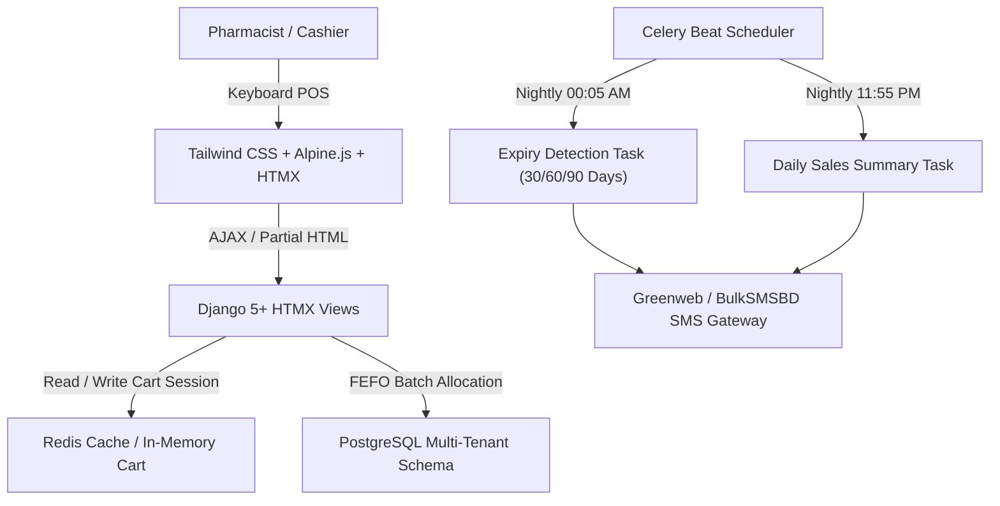

# PharmaFlow SaaS - Bangladesh Retail Pharmacy Management Platform 🇧🇩


লগইন ও রেজিস্ট্রেশন লিঙ্ক:
লাইভ লগইন পেজ: https://pos.webkoders.com/login/
লাইভ রেজিস্ট্রেশন পেজ: https://pos.webkoders.com/register/
মেইন ল্যান্ডিং পেজ: https://pos.webkoders.com/

লগইন এক্সেস ক্রেডেনশিয়ালস:

সুপার এডমিন (SaaS কন্ট্রোল): ইউজারনেম: admin | পাসওয়ার্ড: Admin1234@#
ফার্মেসি ওনার (উত্তরা ব্রাঞ্চ): ইউজারনেম: uttara_owner | পাসওয়ার্ড: Owner1234@#

python restart_live.py
amar লোকাল কোডের  লাইভ প্রোডাকশন সার্ভারে সফলভাবে আপলোড koro এবং সার্ভার রিস্টার্ট সম্পন্ন koro

A high-performance, multi-tenant Pharmacy Management SaaS built specifically for retail pharmacies in Bangladesh using **Python**, **Django 5+**, **HTMX**, **Tailwind CSS**, **Alpine.js**, **Redis**, and **PostgreSQL**.

---

## 🏥 Key Bangladesh-Specific Features

1. **DGDA Compliant Medicine Catalog**:
   - Built-in models for Manufacturers (Square, Incepta, Beximco, Renata, etc.), Formulations (Tablet, Capsule, Syrup, IV), Strengths, and Generics.
   - Dual-language search support (English & Bangla Unicode).
   - Preloaded DGDA dataset with Trade Price (TP), Maximum Retail Price (MRP), and standard 2.4% retail drug VAT.

2. **Ultra-Fast Keyboard-First POS**:
   - Single-screen checkout powered by HTMX and Alpine.js with sub-50ms reactive updates.
   - <kbd>F2</kbd>: Focus search box.
   - <kbd>F4</kbd>: Quick discount entry (% or ৳ flat).
   - <kbd>Enter</kbd>: Open tender modal and confirm sale.
   - <kbd>F8</kbd>: Discard/Clear cart.
   - <kbd>Escape</kbd>: Close modals and search dropdown.

3. **FEFO (First Expire, First Out) Inventory Engine**:
   - Automatic batch allocation prioritizing the earliest expiring batch.
   - Expiry alert pipeline (30, 60, and 90-day warning alerts via Celery).

4. **Baki Khata (Customer Credit Ledger)**:
   - Full due tracking with customer mobile lookup.
   - Partial payment settlement and instant Bangla SMS receipts.

5. **Local Payments & SMS Integration**:
   - Ready adapters for **bKash**, **Nagad**, **Rocket**, and Cash.
   - **Greenweb SMS** and **BulkSMSBD** adapters for due payment reminders, invoice receipts, and daily sales summaries to pharmacy owners.

6. **Thermal Receipt Printing**:
   - ESC/POS raw command byte stream generator for 58mm/80mm thermal receipt printers.
   - Clean printable HTML layout with automatic print dialog trigger.

---

## 🏗️ Architecture & Tech Stack



---

## 🚀 Setup & Installation Instructions

### 1. Prerequisites
- Python 3.11+
- PostgreSQL 15+
- Redis 7+

### 2. Virtual Environment & Dependencies
```bash
python -m venv venv
venv\Scripts\activate     # On Windows
# source venv/bin/activate # On Linux/macOS

pip install -r requirements.txt
```

### 3. Database & Environment Setup
Create PostgreSQL database:
```sql
CREATE DATABASE pharmacy_saas_db;
```

Set environment variables (or create a `.env` file):
```env
DB_NAME=pharmacy_saas_db
DB_USER=postgres
DB_PASSWORD=postgres
DB_HOST=127.0.0.1
DB_PORT=5432
REDIS_URL=redis://127.0.0.1:6379/1
CELERY_BROKER_URL=redis://127.0.0.1:6379/2
CELERY_RESULT_BACKEND=redis://127.0.0.1:6379/3
SMS_API_KEY=your_greenweb_or_bulksmsbd_key
SMS_SENDER_ID=PHARMA
```

### 4. Run Migrations & Seed Sample Data
```bash
# Apply django-tenants migrations
python manage.py migrate_schemas --shared
python manage.py migrate_schemas

# Seed realistic Bangladesh medicine catalog, batches, and test customers
python manage.py seed_bd_medicines
```

### 5. Start Background Workers & Web Server

#### Terminal 1: Celery Worker & Beat
```bash
celery -A pharmacy_saas worker -l info --pool=threads
celery -A pharmacy_saas beat -l info
```

#### Terminal 2: Django Development Server
```bash
python manage.py runserver 127.0.0.1:8000
```

Navigate to `http://127.0.0.1:8000/pos/` to launch the POS terminal.
# phermacy
